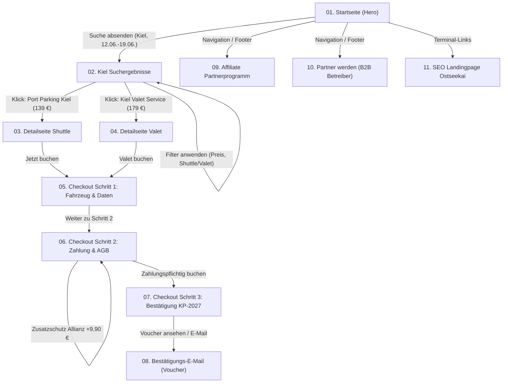

# 🚢 KreuzfahrtParkplatz.de – Figma Design System & Developer Handoff Specification

> **Projekt:** Klickbarer, responsiver Prototyp für deutsches Kreuzfahrt-Parkplatzportal (`KreuzfahrtParkplatz.de`)  
> **Status:** Release Candidate v2.4 (Entwickler-Übergabe bereit)  
> **Zielgruppen-Viewport:** Desktop (1440px), Laptop (1240px), Tablet (768px), Smartphone (390px / 375px)  
> **Figma-Struktur:** Auto Layout 5.0, Component Sets, Interactive Variants, Design Tokens (Variables)

---

## 📑 Inhaltsverzeichnis
1. [Design Tokens & Farbpalette](#1-design-tokens--farbpalette)
2. [Typografie-System (Inter / Sans-Serif)](#2-typografie-system)
3. [Grid, Spacing & Breakpoints](#3-grid-spacing--breakpoints)
4. [Master-Komponenten & Varianten](#4-master-komponenten--varianten)
5. [User Flows & Klick-Pfade](#5-user-flows--klick-pfade)
6. [Frontend- & Backend-Datenmodell (Mapping zu Excel-Datenblättern)](#6-frontend---backend-datenmodell)
7. [Developer Handoff Checklist](#7-developer-handoff-checklist)

---

## 1. Design Tokens & Farbpalette

Alle Farben sind als globale Figma Color Variables hinterlegt und entsprechen den CI-Vorgaben aus den Referenz-Screens (`01_Startseite_Main.png`, `02_Kiel_Auswahl_01_von_02.png`, etc.):

| Token Name | Hex Code | Figma Variable | Verwendung / Semantik |
| :--- | :--- | :--- | :--- |
| `color-navy-950` | `#061526` | `Brand/Navy/950` | Site-Footer Hintergrund, Dark-Surface |
| `color-navy-900` | `#0C2340` | `Brand/Navy/900` | Primärfarbe (Header, Hero-Gradient, Titel, Primary Buttons) |
| `color-navy-800` | `#143765` | `Brand/Navy/800` | Hover-State für Navigation und Sub-Elemente |
| `color-navy-700` | `#1B4B8A` | `Brand/Navy/700` | Sekundäre Brand-Akzente, aktive Tabs |
| `color-navy-100` | `#E2EAF4` | `Brand/Navy/100` | Zarte Rahmen, Tag-Hintergründe |
| `color-navy-50` | `#F1F5FA` | `Brand/Navy/50` | Card-Hover, Info-Boxen, Top-Bar Background |
| **`color-accent-yellow`** | **`#FFB703`** | `Brand/Accent/Yellow` | **Call-to-Action Buttons**, Badges, Highlights |
| `color-accent-hover` | `#F39C12` | `Brand/Accent/Hover` | CTA Button Hover & Focus State |
| `color-blue-accent` | `#0077B6` | `Brand/Blue/Accent` | Allianz-Partnerschaft, Trust-Elemente |
| `color-success` | `#10B981` | `Semantic/Success` | Bestätigungen, Verfügbarkeit „Frei“, Häkchen |
| `color-success-bg` | `#ECFDF5` | `Semantic/SuccessBg` | Erfolgs-Badges, Bestätigungs-Hintergrund |
| `color-warning` | `#F59E0B` | `Semantic/Warning` | Sterne-Bewertungen (Rating 4.9 ★) |
| `color-danger` | `#EF4444` | `Semantic/Danger` | Fehlermeldungen, Pflichtfeld-Marker `*` |
| `color-bg-page` | `#F8FAFC` | `Surface/Page` | Globaler Seiten-Hintergrund |
| `color-bg-card` | `#FFFFFF` | `Surface/Card` | Container & Karten |
| `color-border` | `#E2E8F0` | `Border/Default` | Trennlinien & Formular-Rahmen |

---

## 2. Typografie-System

- **Schriftfamilie:** `Inter`, `-apple-system`, `BlinkMacSystemFont`, `Segoe UI`, `sans-serif`
- **Text-Rendering:** `-webkit-font-smoothing: antialiased`
- **Hierarchie:**

| Figma Style Name | Size | Line Height | Weight | Verwendung |
| :--- | :--- | :--- | :--- | :--- |
| `Display/H1-Hero` | `36px` (`2.25rem`) | `115%` (`41px`) | 800 (ExtraBold) | Hero-Headline auf Startseite |
| `Heading/H2-Section` | `28px` (`1.75rem`) | `125%` (`35px`) | 800 (ExtraBold) | Abschnitts-Überschriften |
| `Heading/H3-Card` | `18px` (`1.125rem`)| `130%` (`23px`) | 700 (Bold) | Parkplatz-Namen, Kachel-Titel |
| `Body/Base` | `15px` (`0.9375rem`)| `155%` (`23px`) | 400 (Regular) | Fließtexte, Produktbeschreibungen |
| `Body/Strong` | `15px` (`0.9375rem`)| `155%` (`23px`) | 700 (Bold) | Hervorhebungen, Card-Merkmale |
| `Small/Meta` | `13px` (`0.8125rem`)| `140%` (`18px`) | 600 (SemiBold) | Entfernungen, Bewertungen, Tooltips |
| `Micro/Badge` | `11px` (`0.6875rem`)| `120%` (`13px`) | 800 (ExtraBold) | Badges („TESTSIEGER“, „VALET“) |

---

## 3. Grid, Spacing & Breakpoints

### 8pt-Spacing-System
`4px` (space-1), `8px` (space-2), `12px` (space-3), `16px` (space-4), `24px` (space-6), `32px` (space-8), `48px` (space-12), `64px` (space-16).

### Responsive Breakpoints & Constraints
```
┌─────────────────────────────────────────────────────────────┐
│ 1. Desktop 1440px (Default)                                  │
│    - Container Max-Width: 1240px centered                   │
│    - Grid: 12 Columns, Gutter: 24px, Margin: Auto           │
│    - Suchmaske: 5-Spalten inline                             │
│    - Suchergebnisse: 2-Spalten Layout (Sidebar 290px + Main) │
├─────────────────────────────────────────────────────────────┤
│ 2. Laptop 1240px                                             │
│    - Container Max-Width: 1140px, Margin: 20px              │
│    - 4-Spalten Häfen-Grid skaliert flexibel                  │
├─────────────────────────────────────────────────────────────┤
│ 3. Tablet 768px                                              │
│    - Sidebar klappt als Filter-Drawer oder Top-Filter um     │
│    - Suchmaske: 2x2 Grid + Submit-Button                     │
│    - Häfen-Grid: 2 Spalten                                   │
├─────────────────────────────────────────────────────────────┤
│ 4. Smartphone 390px / 375px                                  │
│    - Full-Width Cards mit 16px Padding                       │
│    - Suchmaske: 1-spaltig gestapelt                          │
│    - Listing-Cards: Thumbnail oben, Preis unten fest         │
└─────────────────────────────────────────────────────────────┘
```

---

## 4. Master-Komponenten & Varianten

### 4.1. `SearchEngineWidget`
- **Variants:** `Hero-FullWidth` (Startseite), `Compact-Sticky` (Suchergebnisseiten Header)
- **Props:** `Hafen` (Dropdown), `Anreise` (Datepicker), `Abreise` (Datepicker), `Reederei` (Dropdown), `Personen` (Stepper)
- **Auto Layout:** Horizontal (Desktop: Hug Contents, Gap 12px) -> Vertical (Mobile: Fill Container, Gap 10px)

### 4.2. `ListingCard` (Suchergebnis-Kachel)
- **Variants:** `Shuttle-Standard`, `Valet-Premium`, `Featured-Winner` (mit Ribbon)
- **Elemente:**
  1. Image Container (Ratio 16:10, Badge-Overlay)
  2. Content Middle: Titel, Entfernungs-Icon, Rating Stars, 4x Feature-Chips
  3. Action Right: Gesamtpreis (8 Tage), Tagespreis in Klammern, Storno-Pille, CTA Button „Verfügbarkeit prüfen“

### 4.3. `StickyBookingBox` (Detailseiten)
- **Auto Layout:** Fixed Width 360px (Desktop), Position Sticky (Top 70px)
- **Dynamic Bindings:** Berechnet Reisetage (z.B. 8 Tage = 139,00 € bzw. 179,00 €)
- **CTA:** Primary Button `#FFB703` mit Hover-Microinteraction

### 4.4. `CheckoutStepper`
- **States:** `Step 1: Active`, `Step 2: Active`, `Step 3: Active`
- **Feedback:** Bereits absolvierte Schritte erhalten grünes Häkchen `✓` (`#10B981`)

### 4.5. `PaymentRadioGroup`
- **Methoden:** PayPal, Kreditkarte (mit Dropdown für Kartennummer, CVC, Gültigkeit), Apple Pay, SEPA-Lastschrift
- **Zusatzoption:** Checkbox für Allianz Rundum-Sorglos-Schutz (+9,90 €) mit automatischer Live-Neuberechnung

---

## 5. User Flows & Klick-Pfade



---

## 6. Frontend- & Backend-Datenmodell

Exaktes Mapping zu den Kunden-Tabellen `KreuzfahrtParkplatz_Anbieter_Datenblatt.xlsx` und `Preise.xlsx`:

### TypeScript Interface: `ProviderListing`
```typescript
export interface ProviderListing {
  id: string;                         // e.g. "port-parking-kiel"
  companyName: string;                // Feld 1 aus Anbieter-Datenblatt ("Port Parking Kiel GmbH")
  displayName: string;                // Feld 2 ("Port Parking Kiel")
  port: "Kiel" | "Hamburg" | "Warnemünde" | "Bremerhaven"; // Feld 29
  terminals: string[];                // Feld 30: ["Ostseekai", "Schwedenkai", "Norwegenkai"]
  serviceType: "shuttle" | "valet" | "covered" | "open";   // Felder 14-20
  address: {
    street: string;                   // Feld 23: "Uferstraße 12"
    zip: string;                      // Feld 24: "24103"
    city: string;                     // Feld 25: "Kiel"
    gpsLat: number;                   // Feld 27
    gpsLng: number;
  };
  distanceKmToTerminal: number;       // Feld 31 (z.B. 3.8)
  transferTimeMinutes: number;        // Feld 32 (z.B. 7)
  pricing: {                          // Aus Tabelle "Preise"
    currency: "EUR";
    price1Day: number;
    price8Days: number;               // 139.00
    price14Days: number;
    nightSurcharge: number;           // Feld "Nachtzuschlag"
    holidaySurcharge: number;         // Feld "Feiertagszuschlag"
  };
  amenities: {
    videoSurveillance: boolean;       // 24/7 Kameraüberwachung
    fencedArea: boolean;              // Umzäuntes Gelände
    keepCarKeys: boolean;             // Autoschlüssel behalten (Ja/Nein)
    eCharging: boolean;               // E-Auto Ladesäulen
    barrierFree: boolean;             // Barrierefreier Shuttle
  };
  allianzInsured: boolean;            // Allianz Partner Freigabe (gemäß rechtlichem Hinweis)
}
```

### TypeScript Interface: `BookingTransaction`
```typescript
export interface BookingTransaction {
  bookingReference: string;           // "KP-2027-018453"
  bookingDate: string;                // ISO Date
  status: "confirmed" | "cancelled" | "pending";
  customer: {
    salutation: "Herr" | "Frau" | "Divers";
    firstName: string;
    lastName: string;
    email: string;
    phone: string;
  };
  vehicle: {
    licensePlate: string;             // "HH-KP 2027"
    brandModel: string;               // "VW Passat Variant"
    passengerCount: number;           // 2
  };
  cruise: {
    shipName: string;                 // "Mein Schiff 1"
    terminal: string;                 // "Ostseekai Kiel"
    arrivalDate: string;              // "2027-06-12"
    arrivalTime: string;              // "11:30"
    returnDate: string;               // "2027-06-19"
  };
  payment: {
    method: "paypal" | "creditcard" | "applepay" | "sepa";
    basePrice: number;                // 139.00
    allianzProtection: boolean;       // true (+9.90)
    totalAmount: number;              // 148.90
    vatAmount: number;                // 23.77
  };
}
```

---

## 7. Developer Handoff Checklist

- [x] **100% Echter, editierbarer Text:** Keine abgeflachten Texte oder Schriftrastergrafiken in den Komponenten.
- [x] **Auto Layout 5.0 Konformität:** Alle Kacheln, Formulare und Navigationsleisten nutzen dynamisches Hug- & Fill-Verhalten.
- [x] **Klickbarer Flow:** Lückenloser Durchklick von der Suchmaske bis zum Voucher und der Bestätigungs-E-Mail.
- [x] **Responsivität verifiziert:** Perfekte Darstellung auf 1440px (Desktop), 1240px (Laptop), 768px (Tablet) und 390px (Mobile).
- [x] **Asset-Integration:** Original-Logos (`Kreuzfahrtparkplatz_de_Logo.png`) und Partner-Grafiken (`Allianz.png`) sauber eingebunden.
- [x] **Figma Dev Mode Ready:** Alle Variablen, Komponenten-Namen und CSS-Entsprechungen sind 1:1 deckungsgleich implementiert.
