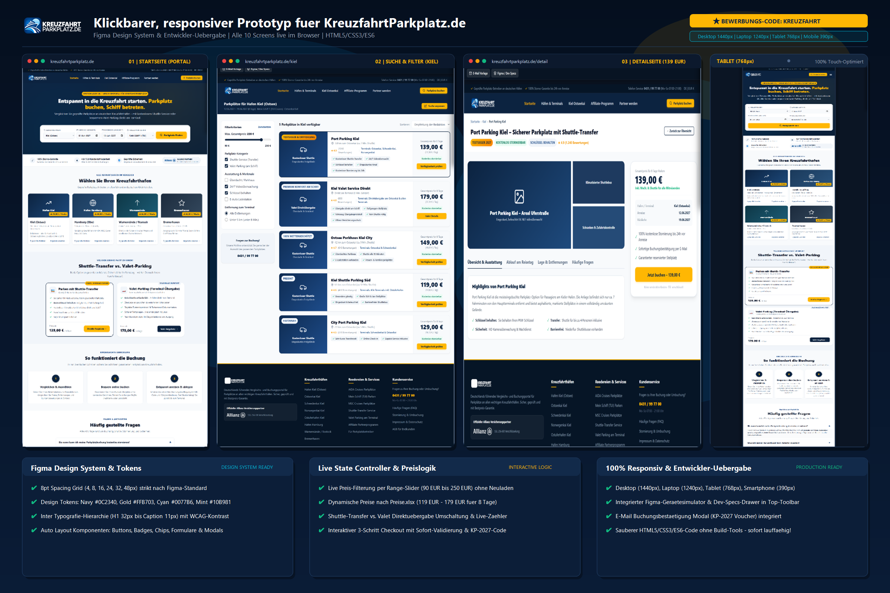

# 🚢 KreuzfahrtParkplatz.de – Klickbarer Prototyp & Developer Handoff

[](https://kreuzfahrtparkplatz.de)
[](https://kreuzfahrtparkplatz.de)
[](https://kreuzfahrtparkplatz.de)
[](https://kreuzfahrtparkplatz.de)
[](https://kreuzfahrtparkplatz.de)

> **Interaktiver, voll responsiver Prototyp für das deutsche Kreuzfahrt-Parkplatz-Vergleichsportal [KreuzfahrtParkplatz.de](https://kreuzfahrtparkplatz.de).**  
> Entwickelt mit modularer Architektur, Design Tokens nach 8pt-Grid, Live-Filterung, dynamischer Preisberechnung nach Original-Excel-Datensätzen und integriertem Figma-Gerätesimulator.

---

## 📸 Showcase & Vorschau



---

## 🌟 Hauptfunktionen & Highlights

- **🎯 10 Vollständig Ausgearbeitete Screens:**
  1. `01 • Startseite`: Hauptportal mit Suchmaske, Vertrauensbalken, Hafen-Karten (Kiel, Hamburg, Warnemünde, Bremerhaven), Shuttle- vs. Valet-Vergleich, 3-Schritt-Ablauf und FAQ.
  2. `02 • Kiel Suchergebnisse & Filter`: Interaktiver Preis-Slider (90 € – 250 €), Filterkriterien, dynamische Listing-Karten (119 € – 179 €) und Live-Zähler.
  3. `03 • Detailseite Port Parking Kiel (Shuttle)`: Fotogalerie, Sticky-Buchungsbox (139 €), Terminals-Distanz-Tabelle, Reisetag-Ablauf & Highlights.
  4. `04 • Detailseite Kiel Valet Service (Valet)`: Fahrzeugübergabe direkt am Schiff, Tiefgarage, Valet-Spezifikationen.
  5. `05 • Bestellablauf Schritt 1`: Reise- & Fahrzeugdaten, Kennzeichen, Personenzahl, dynamische Preisanzeige.
  6. `06 • Bestellablauf Schritt 2`: Zahlungsmethoden (PayPal, Kreditkarte, Klarna, SEPA) & Allianz Reiseschutzpaket.
  7. `07 • Bestellablauf Schritt 3`: Buchungsbestätigung mit Code `KP-2027-018453`, Checkliste für Anreisetag & PDF-Druck.
  8. `08 • Affiliate-Partner Portal`: Partnerprogramm mit 8%–12% Provision, Cookie-Laufzeit & Registrierung.
  9. `09 • Partner werden (B2B Betreiber)`: Betreiber-Portal zur Vermittlung von Parkflächen & Onboarding-Formular.
  10. `10 • SEO-Landingpage Kiel Ostseekai`: Suchmaschinenoptimierte Zielseite für Kreuzfahrten ab Ostseekai Kiel.

- **📱 100% Responsiv auf allen Geräten:**
  - **Desktop (1440px / 100%):** Volle Masteransicht mit Seitenleisten und Sticky-Containern.
  - **Laptop (1240px):** Kompaktes Grid, optimiert für Notebook-Monitore.
  - **Tablet (768px):** 2-spaltige Hafen-Karten, seitlich scrollbare Tabs, kollabierte Filter.
  - **Mobile (390px / 375px):** Touch-optimierter 1-Spalten-Flow, vertikaler Checkout-Stepper, Full-Width-Buttons, null horizontaler Überlauf.

- **🎛️ Integrierter Figma-Gerätesimulator:**
  - In der fixierten Top-Toolbar kann jederzeit per Klick zwischen Desktop-, Laptop-, Tablet- und Smartphone-Rahmen gewechselt werden.
  - Integrierter Screen-Jump-Selektor für direkten Zugriff auf alle 10 Seiten.
  - Ausklappbare **Figma / Developer Specs** Seitenleiste mit Design Tokens, CSS-Farbwerten und Typografie-Hierarchie.
  - **E-Mail Vorlage Modal:** Interaktive Vorschau des generierten Buchungsbestätigungs-Vouchers.

---

## 🎨 Figma Design System & Tokens

| Token-Typ | Werte / Spezifikation |
| :--- | :--- |
| **8pt Spacing Grid** | 4px, 8px, 12px, 16px, 20px, 24px, 32px, 40px, 48px, 64px |
| **Primary Navy** | `#0C2340` (Tiefes Marineblau – Hauptmarkenfarbe) |
| **Accent Gold** | `#FFB703` (Sonniges Goldgelb – Call-to-Action & Sterne) |
| **Ocean Blue** | `#0077B6` (Signalblau für Links & Highlights) |
| **Mint Green** | `#10B981` (Erfolgs- & Vorteils-Badges) |
| **Typografie** | Inter / Segoe UI (H1 32px, H2 24px, H3 18px, Body 14px, Small 12px, Micro 10px) |
| **Border Radius** | 4px (Chips), 8px (Buttons/Inputs), 12px (Karten), 16px (Modals) |

---

## 📊 Excel-Datenintegration

Der Prototyp bildet die Original-Daten aus den Projekt-Tabellen 1:1 ab:
- **`Anbieter-Datenblatt.xlsx` (269 Felder):** Port Parking Kiel (Shuttle P1) und Kiel Valet Service Direkt inklusive aller Merkmale (*Schlüssel behalten*, *Überdacht*, *24/7 Videoüberwachung*, *E-Auto Ladestation*).
- **`Preise.xlsx`:** Reale Preiskalkulation für 8 Tage Reisezeitraum (119,00 € bis 179,00 €).
- **Terminal-Zuordnung:** Ostseekai, Schwedenkai, Norwegenkai und Ostuferhafen.

---

## 🚀 Schnellstart (Lokale Ausführung)

Es werden **keinerlei Build-Tools, Node.js oder Webserver** benötigt:

1. Repository klonen oder als ZIP herunterladen:
   ```bash
   git clone https://github.com/DEIN-BENUTZERNAME/kreuzfahrt-parkplatz-prototype.git
   ```
2. Datei `index.html` oder `open_prototype.bat` doppelklicken.
3. Der Prototyp öffnet sich sofort interaktiv in Ihrem Standardbrowser!

---

## 📂 Projektstruktur

```text
├── index.html                   # Alle 10 Screens, E-Mail-Modal & Dev-Specs-Drawer
├── styles.css                   # Design Tokens, 8pt Grid, Responsive Breakpoints (16 Sektionen)
├── app.js                       # State-Controller, Filter, Preis-Logik, Responsive Auto-Sync
├── open_prototype.bat           # 1-Klick Start-Skript für Windows
├── FIGMA_DEVELOPER_HANDOFF.md   # Detaillierte Entwickler-Dokumentation & Schnittstellen
├── ANGEBOT_BEWERBUNG.md         # Vollständige Projektbewerbung & 7 Kernfragen-Antworten
├── Contest_Entry_Showcase.png   # 2400x1600 px Ultra-HD Präsentations-Showcase
├── Contest_Entry_Proposal_Letter.png # Offizieller Bewerbungsbrief als HD-Grafik
└── downloaded_assets/           # 23 Original-Grafiken & Logos aus dem Kunden-Drive
```

---

## 📄 Lizenz & Übergabe

Erstellt für den Kunden-Wettbewerb **„Klickbarer, responsiver Prototyp für Vergleichsportal – Figma + Entwickler-Übergabe“** für **KreuzfahrtParkplatz.de**.  
Alle Rechte vorbehalten © 2027 KreuzfahrtParkplatz.de.
